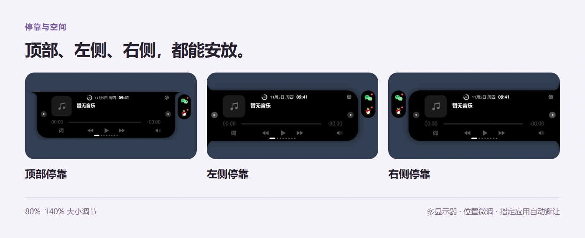
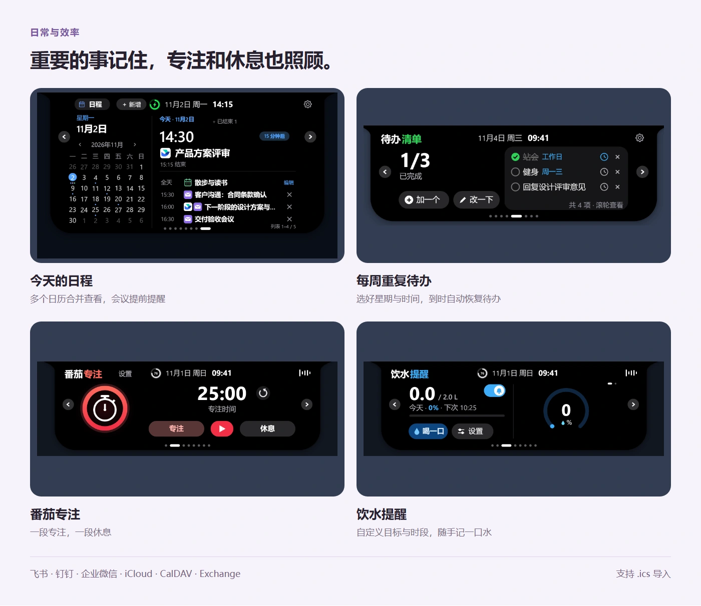

<div align="center">


# 鬼島 桌面靈動島 · Kuidao

**一座島，裝下桌面的日常。**

Windows 桌面靈動島，把通知、音樂、日程、天氣與信箱放到手邊，全繁體中文、台灣用語。

[](LICENSE)
[](#下載安裝)
[](#從原始碼建置)

**[下載 Windows 版](https://github.com/JCnTEA/kuidao-tw/releases/latest)** · [使用說明](docs/USAGE.md) · [更新總覽](hist/更新總覽.html) · [官方網站](docs/index.html)

</div>

鬼島是一款開源的 Windows 桌面工具，台灣在地化版本。平時收在螢幕邊緣，滑鼠靠近就展開；換歌、看行程、複製驗證碼、記一條待辦，都能順手完成。島上的島虎會眨眼、打盹、喝水，也會跟著音樂唱歌。

可以選瀏海或膠囊，放在頂部、左側或右側，只留自己需要的功能。以 Rust 與 egui 打造，不依賴 Electron，常駐佔用低。

> 本專案為台灣在地化版本：軟體本體沿用上游開源專案並跟隨其功能更新；繁中翻譯、在地服務與品牌由本專案維護。

## 島上有什麼

| 模組 | 台灣版做法 |
| --- | --- |
| 通知 | 收起時亮圖示與紅點，展開後看摘要；LINE、Facebook、Instagram、Threads 走系統通知，不讀聊天內容 |
| 音樂 | 播放、暫停、切歌、音量與進度都在島上；展開看歌詞，收起留一行 |
| 日程與待辦 | 月曆與當日時間線、每週重複待辦、番茄專注、飲水提醒 |
| 天氣 | 可選到鄉鎮市區，颱風外圍或午後雷雨時各區狀況不同 |
| 信箱 | Yahoo 奇摩、iCloud、Gmail、Outlook／Hotmail、自訂 IMAP；驗證碼一鍵複製 |
| AI 額度 | 多家服務額度一覽，常駐欄直接顯示剩餘 |

## 外觀與停靠



- **三邊停靠**：頂部橫向展開，左右側邊收起為豎向膠囊，靠近後從邊緣展開。
- **大小與位置可調**：島體 80%–140%；頂部可左右移動，側邊可上下調整。
- **OLED 像素偏移**（預設關閉）：收起靜止時沿停靠邊緩慢移動幾像素，減少烙印。
- **多螢幕與自動避讓**：跟隨主螢幕或固定指定螢幕；被瀏覽器或指定應用遮住時收成貼邊細線。
- **吉祥物**：預設島虎（石虎），可換柴犬；貓、哈士奇、黃金獵犬待動畫補齊後開放。

在 **設定 → 外觀** 調整。

## 聽歌時，歌詞就在抬眼處


播放、暫停、切歌、調整音量與拖動進度都在島上完成。透過 Windows 媒體工作階段讀取播放資訊，支援 Spotify、Apple Music 等國際服務；中國大陸播放器預設隱藏，需要時可在設定中打開。

歌詞取決於歌曲中繼資料與歌詞來源，個別歌曲或播放器版本可能無法顯示。

## 日程、待辦與專注



| 想做的事 | 鬼島幫你 |
| --- | --- |
| 看今天的安排 | 月曆與當日時間線，合併多個日曆與正式會議邀請 |
| 記住每週的事 | 待辦支援單次提醒、每週指定日重複或每天重複 |
| 專心做一件事 | 專注與休息計時，收起時也能看進度 |
| 記得喝水 | 自訂每日目標、單次飲水量、提醒間隔與時段 |

日曆可接 iCloud、自訂 CalDAV 與相容的 Exchange ActiveSync，也能匯入 `.ics`；中國大陸服務（飛書、釘釘、企業微信）預設不顯示。

## 信箱與驗證碼


接多個信箱，在島上看來信、辨識驗證碼並點擊複製。支援內文閱讀與獨立全文視窗，連結交給預設瀏覽器；支援已讀／未讀、全部已讀、移到垃圾桶與復原，預設只在本機整理。

支援 **Yahoo 奇摩、iCloud、Gmail、Outlook／Hotmail、自訂 IMAP**。驗證碼可設 30／60／300 秒後自動隱藏。

## 天氣看得到鄉鎮市區

天氣頁顯示實況與未來七天：溫度、天氣現象、體感、濕度、風速、日出日落，以及每日高低溫與降雨機率。

- 預設依網路出口自動定位，也可在 **設定 → 天氣** 直接搜尋地名，例如「臺北市士林區」「高雄市鼓山區」，選到區一級。
- 資料來自 **Open-Meteo**（免費、免金鑰），每 15 分鐘更新，也可手動重新整理。
- 結果快取在本機，斷網時顯示上次資料並標出更新時間。

## 下載安裝

前往 **[最新版本](https://github.com/JCnTEA/kuidao-tw/releases/latest)**：

| 下載檔案 | 使用方式 |
| --- | --- |
| `GuiDao-DynamicIsland-Setup-v版本-x64.exe` | **建議**。雙擊安裝，可選安裝位置、桌面捷徑與開機自啟 |
| `GuiDao-DynamicIsland-Portable-v版本-x64.zip` | 免安裝。完整解壓後執行 `kuidao.exe` |
| `SHA256SUMS.txt` | 下載校驗，可用 PowerShell `Get-FileHash -Algorithm SHA256` 比對 |

**系統需求**：Windows 10／11 x64。預設 OpenGL，初始化失敗時改試 Direct3D 12。

**更新**：設定 → 關於 → 檢查更新，支援應用內下載與重啟更新；升級保留設定與資料。

## 授權與私人使用

本專案為個人使用版本，內建機器碼授權：首次啟動會顯示機器碼，貼進授權產生器取得授權碼後執行：

```powershell
kuidao.exe --license 授權碼
```

授權檔位置：`%APPDATA%\Kuidao\license.key`。若 Windows 跳出 SmartScreen 攔截，執行倉庫內的 `解除封鎖.bat` 清除標記即可。

## 資料與隱私

- 設定、待辦、本機日程、飲水紀錄、剪貼簿歷史存在 `%APPDATA%\Kuidao`。
- 信箱與日曆密碼、API Key 存在 Windows 認證管理員；需要加密的工作階段用 Windows DPAPI。
- 通知提醒依工作列提示運作，不讀取聯絡人或聊天內容。
- 不設自建的信箱或日程伺服器；聯網時只連線對應服務商。
- 詳細操作見 [使用說明](docs/USAGE.md)。

## 從原始碼建置

需要 Rust stable、MSVC C++ 建置工具與 Windows SDK。

```powershell
rustup default stable-x86_64-pc-windows-msvc
cargo build --locked --release --bin kuidao
.\target\release\kuidao.exe
```

測試與打包：

```powershell
cargo test --locked --all-targets --features record -- --test-threads=1
powershell -NoProfile -ExecutionPolicy Bypass -File .\scripts\package.ps1
```

或直接雙擊 `一鍵編譯免安裝版.bat` 產出綠色版。

## 授權條款與致謝

本專案程式碼採用 [MIT License](LICENSE)。依 MIT 要求，上游著作權聲明保留於 [LICENSE](LICENSE) 與 [第三方聲明](THIRD_PARTY_NOTICES.txt)，不得移除；本專案僅維護繁體中文、在地服務與品牌層。

感謝 egui／eframe、Rust 社群，以及提供參考與素材的開源專案。