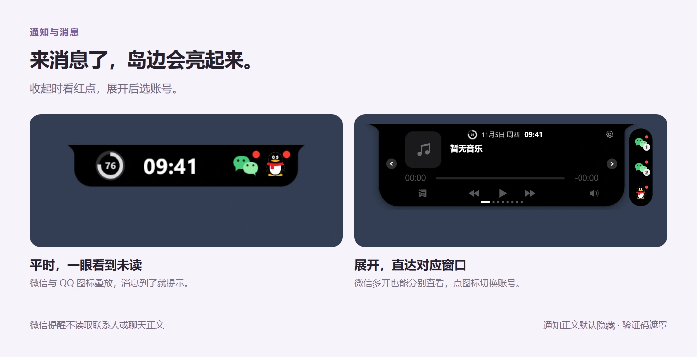
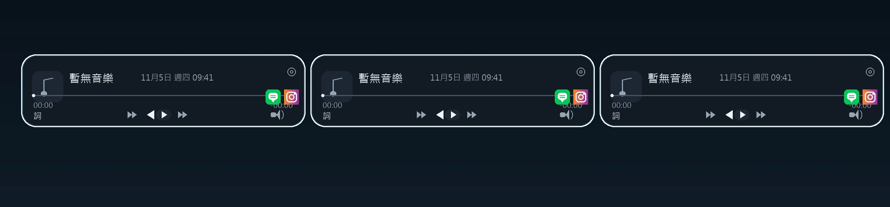
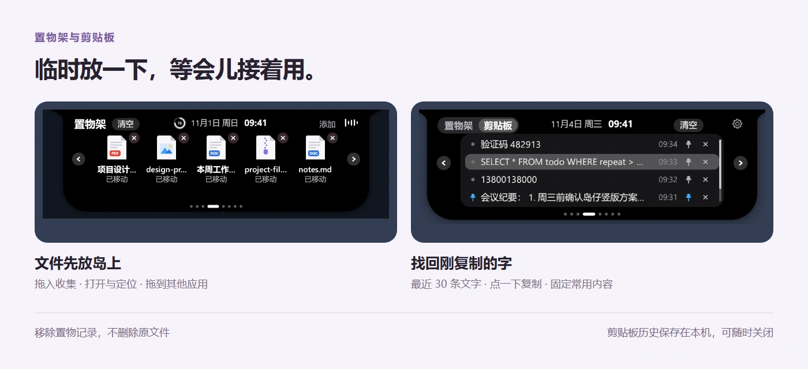
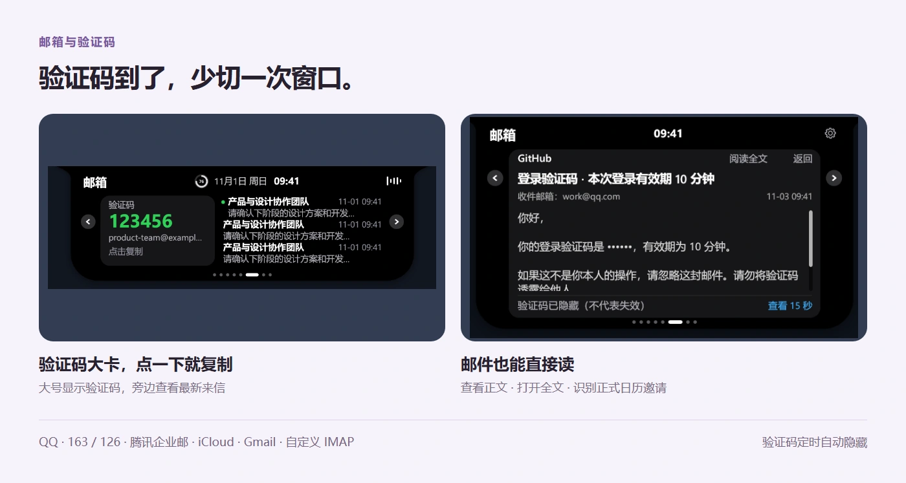
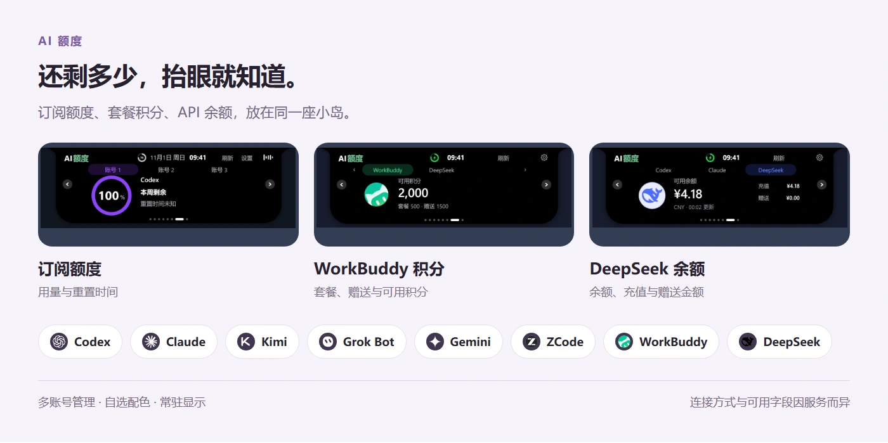

# 島仔 · Daozai

**一座小島，裝下桌面日常。**

Windows 桌面夥伴，把消息、音樂、日程、天氣和 AI 額度放到手邊。

[](https://github.com/Renly1994/xiaotang-daozai/releases/latest)
[](#下載安裝)
[](LICENSE)
[](#從源碼構建與參與開發)

**[下載 Windows 版](https://github.com/Renly1994/xiaotang-daozai/releases/latest)** · [使用指南](docs/USAGE.md) · [更新記錄](CHANGELOG.md) · [反饋問題](https://github.com/Renly1994/xiaotang-daozai/issues)

</div>

島仔是一款開源的 Windows 桌面小工具。平時收起在屏幕邊緣，鼠標靠近就展開；切歌、看日程、複製驗證碼、記一條待辦，都能順手完成。小島裡的夥伴會眨眼、打盹、喝水，也會跟著音樂唱歌。

你可以選劉海或膠囊，放在頂部、左側或右側，只保留自己需要的功能。島仔使用 Rust 和 egui 構建，不依賴 Electron。

## 微信裡有新消息，看一眼島邊



- **微信、QQ 未讀提醒**：收起時亮起圖標和紅點，展開後在面板旁查看，點擊切換到對應窗口。
- **微信多開分開看**：不同賬號分別顯示，點擊對應賬號的未讀圖標即可切換。
- **按需顯示通知正文**：默認隱藏正文；開啟預覽後仍遮罩識別出的驗證碼。
- **微信提醒不讀取聊天正文**：根據任務欄閃動提示新消息。微信縮在托盤時，可選開啟「托盤一鍵喚起微信」。

開啟方式：**設置 → 通知、郵箱與日程 → 通知**。微信開啟「微信新消息提醒」；QQ 選擇「只連接 QQ」，並在 QQ 中啟用 Windows 系統通知。

## 換個皮膚，也換個位置


**五款皮膚 × 兩種形態，自由搭配。** 經典黑、奶油、毛玻璃·淺、毛玻璃·深和「懸浮雲」，都能搭配劉海或膠囊。毛玻璃透出身後的桌面；懸浮雲隨專輯封面換色，光暈跟著鼠標移動。


- **三邊停靠**：頂部橫向展開，左右側邊收起為豎向膠囊，靠近後從屏幕邊緣展開。
- **大小與位置可調**：島體大小支持 80%–140%；頂部可左右移動，側邊可上下調整。
- **OLED 像素偏移**（默認關閉）：收起靜止時沿停靠邊緩慢移動幾個像素，幫助減輕 OLED 靜態顯示留下的痕跡。
- **多屏與自動避讓**：跟隨主屏或固定到指定顯示器。前台瀏覽器或自定義應用的窗口遮住島時，島會收成貼邊細線。切到插件浮窗時，如果名單裡的宿主窗口仍遮住島，島會繼續避讓。
- **按習慣顯示**：支持極簡模式、12／24 小時制，以及功能頁面開關與拖動排序。

在 **設置 → 常規 → 島體外觀／島體顯示** 中調整。島上單行歌詞目前支持頂部停靠。

## 聽歌時，歌詞就在抬眼處



播放、暫停、切歌、調節音量和拖動進度，都能在島上操作。展開看歌詞，也可以收起後只留一行歌詞，讓桌面繼續做自己的事。

- 通過 Windows 媒體會話讀取播放信息，並針對網易雲音樂、QQ 音樂、酷狗、汽水音樂補充兼容。
- 網易雲優先按歌曲 ID 找詞，改善譯名、合唱署名和 Live／Remix 等不同版本的匹配。

播放器需提供可用的媒體信息；歌詞取決於歌曲元數據與歌詞來源，個別歌曲或播放器版本可能無法顯示。

## 日程、待辦和專注，放在一起


| 想做的事 | 島仔能幫你 |
| --- | --- |
| 看今天的安排 | 月曆與當日時間線，合併多個日曆和正式郵件邀請，提前提醒會議 |
| 記住每週的事 | 待辦支持單次提醒、每週指定日期重複或每天重複；下一次到來時恢復為待辦 |
| 專心做一件事 | 專注與休息計時，收起時也能查看進度 |
| 記得喝水 | 自定義每日目標、單次飲水量、提醒間隔與時段，記錄錯誤可撤銷 |

日曆可接入 **飛書、釘釘、企業微信、iCloud、自定義 CalDAV 和兼容的 Exchange ActiveSync**，也能導入 `.ics` 文件。相同日程合併去重；支持全天、跨天和重複日程。

本機新建或導入的日程保存在本機；遠程日曆為只讀同步。程序退出、電腦關機或睡眠期間無法持續提醒。

## 文件先放島上，剛複製的字也能找回



**文件置物架**：拖入文件臨時收集，點擊打開、定位原文件，或拖出到其他應用。移除記錄不會刪除原文件。

**文字剪貼板**：找回最近複製的 30 條文字，點一下重新複製，常用內容可以固定。歷史保存在本機，重啟後仍可查看；可在 **設置 → 待辦與置物 → 剪貼板** 中關閉。密碼管理器標記為敏感的內容不記錄。

## 驗證碼少切一次窗口，郵件也能直接讀



連接多個郵箱，在島上查看來信、識別驗證碼並點擊複製。郵件支持正文閱讀與獨立全文窗口，網頁鏈接交給默認瀏覽器打開；正式日曆邀請可進入日程。支持已讀／未讀切換、全部已讀、移到回收站及恢復；默認僅在本機整理，可在郵件設置中開啟「同步郵件操作到郵箱」。

支持 **QQ、163、126、騰訊企業郵、iCloud、Gmail 和自定義 IMAP**。驗證碼可設置在 30／60／300 秒後自動隱藏，覆蓋列表、正文與通知；主動查看後會再次隱藏。

## AI 還剩多少額度，抬眼就知道



支持 **Codex、Claude、Kimi、Grok Bot、Gemini、GLM Coding Plan、WorkBuddy、DeepSeek 和 Kiro**。

訂閱額度、重置時間、套餐積分與 API 餘額，按服務展示。多個賬號可分別命名、選擇配色，常用賬號直接放在收起的小島上。

- **GLM / ZCode**：填寫 Coding Plan 套餐 Key 查詢額度。本機 ZCode 的舊連接可在 AI 額度設置中重新連接；Start Plan 體驗額度在 ZCode 官方客戶端查看。
- **Claude**：只讀取桌面版本地用量歷史與緩存，或接收 Claude Code 官方狀態欄輸出；島仔不使用 Claude 登錄令牌，也不請求 Claude 額度接口。數據隨官方客戶端使用更新，桌面版緩存有效時自動顯示重置時間，讀取不到時顯示未知。
- **Kiro**：只讀識別 Kiro 登錄緩存並核驗用戶，顯示套餐、有效試用與贈送 / 加購點數及明細，超額上限單獨顯示；支持美國東部和歐洲中部區域。不自動續期，登錄過期時請在 Kiro 中重新登錄。
- **WorkBuddy**：查看剩餘積分；優先識別本機客戶端登錄，也可在默認瀏覽器完成授權。
- **Gemini**：支持 Chrome 144+ 原生授權連接，讀取官網的 5 小時與每週額度，無需擴展。先在 Chrome 登錄 Gemini，首次在 `chrome://inspect/#remote-debugging` 開啟連接，回島仔點擊連接並在 Chrome 允許授權；會話加密保存在本機，後續獨立刷新。高級設置保留手動 Cookie 連接。
- **DeepSeek**：使用 API Key 連接，查看賬戶餘額、充值與贈送金額。
- **中轉站**：自動識別通用餘額、New API 和 Sub2API，保留 One API 兼容計費接口；New API 可用用戶 Token 查詢賬戶餘額。高級設置支持粘貼 CC Switch 的 `request` / `extractor` 自定義查詢腳本，腳本與憑據加密保存在本機。

連接方式、可用字段與賬號訂閱有關；請求失敗或登錄過期時，以對應服務的官方頁面為準。

## 出門前先看一眼天氣

天氣頁顯示當前實況與未來七天預報：溫度、天氣現象、體感、溼度、風速、日出日落時間，以及每天的最高／最低溫和降水概率。

- 默認按當前網絡出口自動定位，**設置 → 天氣** 裡也可以填城市名（中英文都行），或點「自動定位」清除。城市輸入按回車或點「刷新天氣」後生效。
- 數據來自 **Open-Meteo**（免費、無需密鑰），每 15 分鐘自動更新，也可以在頁面右上角手動刷新。天氣請求優先直連，必要時再嘗試已配置的代理；定位主服務失敗時嘗試備用服務。同一城市請求間隔至少 30 秒，失敗後至少 2 分鐘；關閉天氣模塊後停止後續自動查詢。
- 可選 **和風天氣（自備 Key）**：在天氣設置填寫專屬 Host 和 API Key，測試通過並選擇和風城市後點「保存並啟用」。僅需 GeoAPI 與天氣預報兩類權限，Key 保存在 Windows 憑據管理器；配置可收起，配置網站與離線長圖教程在配置標題旁；支持省份下拉、自動模糊搜索和獨立保存最多 5 個城市。和風與默認源的城市、緩存分開，實況約每 60 分鐘、七日預報約每 6 小時更新。本機每自然月最多 5,000 次請求；和風賬號合計前 50,000 次免費，超額可能收費。
- 結果緩存在本機：斷網時繼續顯示上次的數據，並用橙色標出更新時間。
- 島收起時常駐欄默認在時間後面顯示天氣圖標和當前溫度（如 `🌧 9°`），點它直接進天氣頁；可在「頁面管理 → 常駐排列」中獨立拖動天氣，在「狀態組件」中單獨關閉常駐天氣，天氣頁仍可使用。

## 還有這些順手的小功能

電源與電量、網絡變化、音量、大寫鎖定、輸入語言、藍牙設備狀態，都能在小島上提示。通知、藍牙監聽與不常用的功能頁可以按需關閉。

## 下載安裝

前往 **[最新正式版](https://github.com/Renly1994/xiaotang-daozai/releases/latest)**，按使用習慣選擇：

| 下載文件 | 使用方式 |
| --- | --- |
| `Daozai-Setup-v版本號-x64.exe` | **推薦**。雙擊安裝，可選擇安裝位置、桌面快捷方式和開機自啟 |
| `Daozai-v版本號-windows-x64.zip` | 免安裝。完整解壓後運行 `daozai.exe`，用戶數據仍保存在應用數據目錄 |
| `SHA256SUMS.txt` | 下載校驗，可用 PowerShell `Get-FileHash -Algorithm SHA256` 比對 |

首次安裝默認創建桌面快捷方式、不開機自啟。安裝後從小島或托盤打開設置，選擇需要的功能和連接。

**更新**：設置 → 關於 → 檢查更新。支持應用內下載、校驗後重啟更新，也可從發佈頁下載覆蓋安裝；升級保留原設置和數據，卸載同樣保留用戶數據。下載窗口提供夸克網盤備用入口。

**系統**：Windows 10／11 x64。默認使用 OpenGL，初始化失敗時自動嘗試 Direct3D 12。Windows 11 已進行本機實測，Windows 10、不同顯卡及多屏組合仍需更多反饋。暫不提供 macOS、Linux 或 ARM64 成品包。

當前程序未做商業代碼簽名，Windows 可能提示未知發佈者；請核對倉庫來源與文件校驗值。更多操作見 [使用指南](docs/USAGE.md)。

<details>
<summary><b>連接服務之前，需要準備什麼？</b></summary>

| 類型 | 支持入口 | 需要準備 |
| --- | --- | --- |
| 郵箱 | QQ、163、126、騰訊企業郵、iCloud、Gmail、自定義 IMAP | 啟用 IMAP，填寫授權碼或 App 專用密碼；自定義服務可填寫服務器、端口與登錄用戶名 |
| 日曆 | 飛書、釘釘、企業微信、iCloud、CalDAV、Exchange ActiveSync | 服務商提供的日曆同步憑據與必要的服務器地址；安裝桌面客戶端不等於授權 |
| AI 額度 | Codex、Claude、Kimi、Grok Bot、Gemini、GLM Coding Plan、WorkBuddy、DeepSeek、Kiro | 對應客戶端登錄、獨立授權或 API Key；具體以設置中的連接入口為準 |

QQ 收信、郵件日程和飛書個人日曆已進行真實賬號測試。其他日曆入口的可用性與服務端配置、權限和兼容性有關；釘釘、企業微信尚未完成本輪真實賬號同步驗收。

</details>

<details>
<summary><b>數據與隱私</b></summary>

- 設置、待辦、本機日程、飲水記錄、剪貼板歷史、置物路徑與連接元數據保存在 `%APPDATA%\Daozai`。
- 郵箱和日曆密碼、DeepSeek API Key 保存在 Windows 憑據管理器；獨立 Gemini、WorkBuddy 會話使用 Windows DPAPI 加密。
- 微信新消息提醒根據任務欄閃動工作，不讀取聯繫人或聊天正文；QQ 與應用通知需要相應的系統通知權限。
- 讀取已有 AI 客戶端登錄時不回寫原客戶端配置。不要把授權碼、Cookie、API Key 或登錄 JSON 上傳到 Issue。
- 郵箱讀取收件箱，不讀取垃圾郵件文件夾；郵件正文在當前進程中用於展示和識別。
- 島仔沒有自建的郵件或日程上傳後台；開啟聯網功能後，會訪問對應服務商與歌詞服務。
- 天氣只用城市名或由定位服務給出的經緯度查詢 Open-Meteo；自動定位通過 `ipwho.is` 獲取大致城市，失敗時嘗試 FreeIPAPI，不讀取賬號信息。最近一次天氣結果緩存在 `%APPDATA%\Daozai\weather-cities.json`；本機連接診斷只記錄服務域名、請求階段、路由、耗時及錯誤類別，不記錄 IP、座標或代理憑據，不會自動上傳。

完整說明見 [隱私與安全](docs/PRIVACY.md)。

</details>

<details>
<summary id="從源碼構建與參與開發"><b>從源碼構建與參與開發</b></summary>

需要 Rust stable、MSVC C++ 構建工具和 Windows SDK。

```powershell
rustup default stable-x86_64-pc-windows-msvc
cargo build --locked --release --bin daozai
.\target\release\daozai.exe
```

運行測試及打包：

```powershell
cargo test --locked --all-targets --features record -- --test-threads=1
powershell -NoProfile -ExecutionPolicy Bypass -File .\scripts\package.ps1
```

測試按單線程運行，以隔離使用進程環境變量的數據目錄測試。低內存設備可設置 `$env:CARGO_BUILD_JOBS = "1"`。打包需要 NSIS 3，可通過 `-NsisCompiler` 指定 `makensis.exe`。

項目結構、界面預覽與貢獻方式見 [開發指南](CONTRIBUTING.md)。

</details>

## 開源與致謝

島仔原創代碼採用 [MIT License](LICENSE)。Rust 依賴、vendored 代碼、第三方圖標及品牌標識沿用各自的許可或權利聲明；MIT 不授予服務商標使用權，也不代表官方合作或認證。詳見 [第三方聲明](THIRD_PARTY_NOTICES.txt) 和 [依賴說明](docs/DEPENDENCIES.md)。

「懸浮雲」皮膚作者：啵（[@hanhb123](https://github.com/hanhb123)）。感謝 egui／eframe、Rust 社區，以及提供參考與素材的開源項目。

## 感謝支持


喜歡島仔的話，歡迎點一個 **Star**，也可以在 **設置 → 關於 → 支持作者** 請島仔喝杯咖啡。
