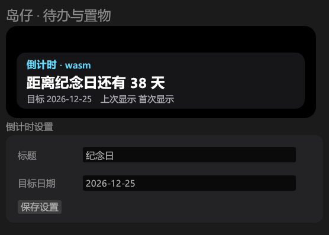

# 島仔插件運行環境實測

**評審建議：首發優先考慮 QuickJS。** 島仔已經隨應用發佈 QuickJS，作者可以用文本編輯器改腳本；WASM 的優勢是 Rust 業務邏輯可以繼續用 Rust 編寫，指令額度也更容易重複測試。本次只驗證同一款倒計時。一次載入十個實例的熱中位數為 WASM 4.12 ms、QuickJS 12.28 ms；兩者的體積增量分別為 1.163 MiB 和 0.152 MiB。如果首發作者主要是已有 Rust 模塊的維護者，值得拿他們實際要遷移的模塊再比較一次。最終選型由小唐決定。

## 同一款插件，兩套實現

使用者在「待辦與置物」設定標題和目標日期，展開島後看到“距離紀念日還有 N 天”。宿主提供按本地日曆計算的目標日和今天的日期序號，插件算差值，先讀上次顯示值再存本次結果。宿主繪製卡片、校驗配置並原子寫盤。兩個引擎各用自己的數據目錄。對照樣本使用同一套繪製、設定控件、刷新節奏和存儲橋接。

| 真實窗口截圖 | QuickJS | WASM |
| --- | --- | --- |
| 同一程序的獨立驗證窗口 |  |  |

截圖由 eframe 渲染並讀回幀緩衝。驗證窗口調用與島內實驗入口相同的 `View::draw`、`View::settings`，獨立運行便於複測。正常島體的入口是 `--sdk-live`，在本次驗證中臨時使用待辦頁和對應設定頁；正式模塊註冊、集市和通用設定渲染屬於後續 SDK 工作。

## 同機對比

| 維度 | QuickJS · rquickjs 0.8.1 | WASM · wasmi 0.46.0 |
| --- | --- | --- |
| release 程序（預設 22,366,208 B） | 22,525,440 B；增加 **0.152 MiB** | 23,585,792 B；增加 **1.163 MiB** |
| 載入 1 個（首輪 / 熱中位 / 熱 P95） | 20.95 / **1.24** / 1.69 ms | 14.43 / **0.41** / 0.88 ms |
| 載入 10 個（首輪 / 熱中位 / 熱 P95） | 50.28 / **12.28** / 13.86 ms | 31.89 / **4.12** / 5.84 ms |
| 11 月 17 日舊驗證窗口的進程 CPU（複測見下文） | 4015.62 ms / 30.02 s（單核 13.378%） | 937.50 ms / 30.01 s（單核 3.124%） |
| 同一採樣窗口的進程 CPU 週期數 | 9,930,499,926 週期 | 2,406,870,340 週期 |
| 進程工作集（中位 / 峰值） | 79.66 / 83.92 MiB | 80.24 / 80.87 MiB |
| 只刷新數據，無窗口（單核 CPU / 工作集中位） | 0.00 ms / 30.01 s；10.99 MiB | 0.00 ms / 30.01 s；11.07 MiB |
| 死循環 / 異常 / 超記憶體後 | 3/3 中止；同一實例均能再次刷新，死循環在 30.635 ms 返回 | 3/3 中止；同一實例均能再次刷新，死循環在 0.125 ms 返回 |
| 權限 | 未聲明請求 -1、已聲明 204；文件模塊和直連網路入口不可用 | 未聲明請求 -1、已聲明 204；未註冊的 WASI 文件導入連結失敗 |
| 作者代碼行數（倒計時 / 含故障用例） | 6 / 14 行；直接運行腳本 | 19 / 38 行；Rust 編譯為 335 字節 WASM |
| 儲存一行到出現新畫面（單次） | 519 ms，含準備 0.9 ms | 2551 ms，含準備 2068.9 ms |
| 從本體抽取數字範圍（原控件 1 行） | 新腳本 5 行代碼；3/3 輸入符合原範圍 | 新 Rust 源碼 16 行；3/3 輸入符合原範圍 |
| 依賴和 CI 實際運行 | 沿用既有引擎；本次跑過腳本、Windows 宿主編譯、截圖 | 鎖文件新增可選解釋器依賴樹；本次額外安裝 WASM 編譯目標，編譯、連結並運行兩個插件樣本 |

測量日期為 2026 年 11 月 17 日。基線提交 `efb8266`，Windows x64、Intel Core i5-12450H、12 個邏輯處理器、16 GB 記憶體。三份 exe 均用 Rust 1.96.1、同一份鎖文件、同一 release 配置（LTO、單代碼生成單元、剝離符號）。增量包含共用的驗證窗口、命令行和測量代碼。1 MiB = 1,048,576 字節。完整數據見[測量結果](evidence/results.json)、[QuickJS 載入原始樣本](evidence/js-load.json)、[WASM 載入原始樣本](evidence/wasm-load.json)。

載入計時包括讀插件與配置、實例化、第一次回調和存儲；10 個插件在同一進程內保持 10 份實例，同時存活。每組先跑一次，再重複 20 次取中位數與第 95 百分位。第一輪包含文件系統緩存狀態的影響；時間從宿主開始裝插件算起。運行開銷按可見驗證窗口每秒刷新一張卡測量，預熱 3 秒後每秒取一次工作集，共 30 次。CPU 百分比按一個邏輯核折算，包含宿主、窗口事件、繪製和引擎，不能據一次低負載採樣判斷引擎快慢。作為對照，無窗口模式每秒調用同一條刷新路徑，共完成 35 次，取中間 30 秒的 CPU 和工作集；Windows 進程 CPU 計時可能捨入到 0。修改時延從儲存一行“天數 +1”算起，含必要的編譯、重新啟動驗證窗口、讀回並儲存畫面；另用獨立進程核對天數確實增加。這裡沒有實現開發者模式的自動熱重載。

## 11 月 19 日複測：窗口為什麼會出現四倍差距

**原表比較的是兩個窗口進程在各自 30 秒內的總 CPU。用這個數字估算插件執行成本，會把桌面觸發的重繪也算給引擎。** 舊預覽只在打開時建立一次引擎；之後每次繪製先判斷是否到了刷新時間，真正到期才調用插件。正常島體的本地開發包則在每次刷新時新建環境並在後台執行。兩條路徑見[預覽](../../spike/ui.rs)和[本地插件](../../spike/local.rs)。

先重跑原來的兩個 release 文件，沿用預熱 3 秒、取 30 秒的口徑，按 QuickJS、WASM、WASM、QuickJS 順序執行，單核 CPU 依次為 0.260%、0.156%、0.104%、0.208%。隨後將兩種引擎編入**同一個程序**，給窗口加上繪製次數、實際調用次數以及刷新函數總耗時三個計數。每個新窗口首次報告計數後再預熱 5 秒，採 20 次，每次間隔約 1 秒。

| 窗口條件 | 引擎 | 實測繪製幀數 | 實際調用次數 | 全部刷新累計耗時 | 進程單核 CPU |
| --- | --- | ---: | ---: | ---: | ---: |
| 原垂直同步，第 1 輪 | QuickJS | 136 | 12 | 0.234 ms | 9.592% |
| 原垂直同步，第 1 輪 | WASM | 22 | 11 | 0.175 ms | 0.149% |
| 原垂直同步，交換順序 | WASM | 22 | 11 | 0.173 ms | 0.000%¹ |
| 原垂直同步，交換順序 | QuickJS | 22 | 11 | 0.254 ms | 0.682% |
| 與正常島體一致，關閉垂直同步 | QuickJS | 22 | 11 | 0.261 ms | 0.376% |
| 同上 | WASM | 22 | 11 | 0.206 ms | 0.301% |
| 關閉垂直同步，每 16 ms 請求重繪 | QuickJS | 29,943 | 21 | 0.423 ms | 129.457% |
| 同上 | WASM | 30,841 | 22 | 0.373 ms | 129.546% |

¹ Windows 進程時間按時間片計量，短區間可能讀到零。表中按一個邏輯核折算；多個線程合計可以超過 100%。幀數與調用數來自窗口約每秒發佈的計數，起止點與進程採樣可能相差一個發佈間隔。

同一個 QuickJS 程序在原窗口設定下，兩輪用掉的進程 CPU 時間分別為 1921.875 ms 和 140.625 ms，腳本刷新總耗時卻相差不到 0.03 ms。第一輪實際多畫 114 幀，窗口有 6 個採樣點處於後台。再只加快重繪，兩種引擎都升到約 129.5%，腳本仍約每秒調用一次。這裡 16 ms 是請求值，egui 會先扣掉預計的繪製時間，短請求可觸發立即重畫。故意加密重繪的兩行僅用於驗證原因。[egui 的重繪調度](../../vendor/egui/src/context.rs)

複測定位到了**窗口渲染負載和採樣條件**，排除了“QuickJS 每幀重新解析或執行倒計時”對這個差距的解釋。驗證窗口已與 Windows 正常島體採用相同的垂直同步設定。11 月 17 日沒有記錄當時的幀數、焦點和驅動等待，無法回推當日究竟是哪次窗口事件造成 13.378%，也沒有證據把整個差額都歸給垂直同步。

### 正常島體裝十個插件

這裡啟動的是正常島體，使用同一份帶兩種引擎的 release 程序和獨立的數據目錄。為保留日常使用的島仔，測量實例跳過單實例檢查、託盤圖標和安裝體積登記。每個已啟用的包有自己的 ID、設定和儲存記錄，使用發薪倒計時的真實腳本，另在存儲裡記下成功刷新次數。原生窗口、模塊檢查、後台運行插件、繪製和系統採樣均使用正常入口。

| 開啟的倒計時 | 採樣時長 | 單核 CPU | 工作集中位 / 峰值 | 各插件成功調用次數（開始 → 結束） |
| --- | ---: | ---: | ---: | --- |
| 0 個 | 72.44 s | 11.540% | 129.71 / 133.75 MiB | 無插件 |
| 10 個 | 70.12 s | 11.276% | 131.23 / 133.89 MiB | 每個均為 1 → 2 |
| 10 個 | 71.55 s | 11.858% | 131.13 / 135.04 MiB | 每個均為 1 → 2 |
| 0 個 | 70.91 s | 11.215% | 129.96 / 132.52 MiB | 無插件 |

十個倒計時的兩輪工作集中位為 **131.13–131.23 MiB**，比兩輪空島的中位約多 1.2–1.5 MiB。十插件進程的單核 CPU 為 **11.276%–11.858%**。四輪都在可見的 Windows 桌面測量；最後三輪都在 70 個採樣點檢測到滑鼠位於島體窗口範圍內。進程值包含島體繪製及其他後台工作，兩個小範圍樣本不足以給出每個插件的固定 CPU 成本。本次負載是每分鐘更新一次的文字卡片，實時歌詞或外部設備查詢需要各自實測。[逐輪數據、桌面狀態和程序哈希](evidence/cpu-review.json) · [複測腳本](../../spike/measure_cpu.py)

## 故障、權限與重啟

| 注入的情況 | QuickJS 實際返回 | WASM 實際返回 |
| --- | --- | --- |
| 死循環 | `Err(Exception)`；30.635 ms | `Err(Error { kind: TrapCode(OutOfFuel) })`；0.125 ms |
| 異常 | `Err(Exception)`；0.215 ms | `Err(Error { kind: TrapCode(UnreachableCodeReached) })`；0.003 ms |
| 記憶體上限 | `Err(Exception)`；0.246 ms | `Err(Error { kind: TrapCode(GrowthOperationLimited) })`；0.009 ms |
| 未聲明聯網 | `Ok(-1)`；0.816 ms | `Ok(-1)`；0.054 ms |
| 已聲明模擬傳輸 | `Ok(204)`；0.007 ms | `Ok(204)`；0.019 ms |
| 直接文件訪問 | `Exception generated by QuickJS` | `cannot find definition for import wasi_snapshot_preview1::path_open with type Func(FuncType { core: FuncType { params: [], results: [] } })` |

JS 為每個實例設定 4 MiB 堆、128 KiB 棧和 30 ms 中斷期限。WASM 每次調用補充 100,000 單位指令額度，單實例限制一塊 4 MiB 線性記憶體、一張最多 1,024 項的表，超限增長直接陷入錯誤。WASM 指令額度與牆鍾時間沒有固定換算。每次執行故障、拒絕請求或接受模擬請求後，測試都立即在**原宿主進程、原實例**刷新一次，要求它提交有效天數。

允許域名為 `allowed.example`；宿主在解析 HTTPS 地址、核對主機和端口後才進入記憶體傳輸端。未聲明域名的調度次數增量必須為 0，允許域名必須為 1。文件探針分別嘗試使用 JS 的文件模塊、導入 WASI 文件函數；兩者均未向插件提供操作系統文件句柄。本次沒有發公網請求，也沒有實現重定向、DNS 地址複核或生產文件選擇器。故障演示覆蓋腳本異常、指令耗盡和受限記憶體分配。引擎自身的原生崩潰、解析器漏洞或阻塞的宿主函數仍需獨立進程與宿主側限時兜底。

兩套 release 程序各啟動兩次。QuickJS 首次返回 38 天、上次值為空，重啟讀回“旅行”、2026-12-25、上次 38 天；WASM 首次返回 38 天、上次值為空，重啟讀回“旅行”、2026-12-25、上次 38 天。

## 作者與維護者要改什麼

- **倒計時源碼。** [JavaScript 插件](../../spike/plugins/countdown.js)和 [Rust/WASM 插件](../../spike/plugins/countdown.rs)共享一份[樣例配置](../../spike/plugins/settings.json)。顯示文案、標題/日期輸入和儲存由宿主提供。實測行數按倉庫內非空源碼行計算；故障探針單列，Rust 計入無需標準庫的入口和導入聲明。
- **從健康設定拆一段。** 取現有 `src/extras.rs` 的喝水提醒數字控件，原調用 1 行，範圍 5–180 分鐘。生產設計把範圍、單位和設定歸屬放到清單，宿主繼續畫原控件。本驗證把日期差當作合成分鐘輸入，分別執行[腳本版](../../spike/migration/interval.js)和 [Rust 版](../../spike/migration/interval.rs)，測上下界與原有存儲接口。兩者都實測 4 → 5、45 → 45、181 → 180。抽樣覆蓋範圍規則，完整喝水模塊的通知排程、UI 和後台恢復未遷移。
- **依賴維護。** 現有中轉站腳本使用 `rquickjs 0.8.1`，驗證沿用鎖文件。WASM 使用可選 `wasmi 0.46.0`，關閉預設特性，僅啟用 std，不連結 WASI。查詢時兩項目均有 2026 年發行記錄：rquickjs 0.14.0（9 月 18 日）、wasmi 2.0.0（9 月 1 日）。發佈活動不能證明當前鎖定版本仍獲安全修復；正式接收社區代碼前需評估升級，並復跑舊插件原包。上游記錄見 [rquickjs](https://crates.io/crates/rquickjs/versions) 和 [wasmi](https://crates.io/crates/wasmi/versions)。
- **CI 與普通作者。** 兩套宿主均用項目原有 Windows Rust/MSVC release 構建。JS 作者改文本即可；Rust 插件作者或重建其製品的 CI 需額外安裝 `wasm32-unknown-unknown` 並將源編為字節碼。普通使用者安裝現成 WASM 包無需此工具鏈。測量腳本另需 Python、psutil 及能建立原生窗口的 Windows 會話。宿主 SDK、權限和舊包迴歸仍是兩種路線共有的維護工作。

## 本地複驗

在此分支倉庫根目錄打開 PowerShell。預設構建不打開驗證功能；下面分別構建並保留三份完整程序，每份使用同一份 Cargo.lock。

```powershell
$tc = '+stable-x86_64-pc-windows-msvc'
$triple = 'x86_64-pc-windows-msvc'
rustup target add wasm32-unknown-unknown --toolchain stable-x86_64-pc-windows-msvc
rustc $tc --target wasm32-unknown-unknown --crate-type cdylib -C opt-level=s -C panic=abort -C link-arg=-zstack-size=65536 -C strip=symbols spike/plugins/countdown.rs -o spike/plugins/countdown.wasm
foreach ($kind in 'base','js','wasm') {
    $features = @()
    if ($kind -ne 'base') { $features = @('--features', "sdk-$kind") }
    powershell -NoProfile -ExecutionPolicy Bypass -File spike/cargo-serial.ps1 build --locked --release --bin daozai --target $triple @features
    if ($LASTEXITCODE -ne 0) { throw "構建失敗：$kind" }
    Copy-Item "target/$triple/release/daozai.exe" "target/spike-$kind.exe"
}
powershell -NoProfile -ExecutionPolicy Bypass -File spike/cargo-serial.ps1 test --locked --lib --target $triple -- --test-threads=1
```

- **試用設定與重啟。** 運行 `./target/spike-js.exe --sdk-spike js ui`，把標題改為“發薪”，填入目標日期，點儲存。關閉窗口後重開，可核對標題、日期和上次顯示的天數。將文件名與參數裡的 `js` 一起改成 `wasm` 即可對照。體驗完整島體時可在退出既有島仔實例後運行 `./target/spike-js.exe --sdk-live js` 或 `./target/spike-wasm.exe --sdk-live wasm`；展開待辦頁看卡片，從待辦對應設定調參數。
- **複測與截圖。** 安裝 Python 的 `psutil` 後運行 `python -X utf8 spike/measure.py target/review-01`。每次指定一個新目錄，腳本複製樣例供修改，測試設定、截圖和原始數據均寫到該目錄。兩次手工打開驗證窗口預設共用臨時目錄下的 `daozai-sdk-spike/<引擎>/ui`；可用 `DAOZAI_SPIKE_DATA` 指向全新目錄，`DAOZAI_SPIKE_PLUGINS` 指向自己的樣例複製件。
- **迴歸。** 預設 release 構建成功；按任務指定命令運行現有庫測試，1280 項通過、0 項失敗，另有倉庫原標記忽略的 129 項。SDK 驗證單獨運行，不計入這 1280 項。

正式權限和版本約定、建議值及待決定事項見 [SDK v1 設計評審稿](sdk-v1-design.md)。

### 重做本輪 CPU 採樣

從倉庫根目錄運行以下命令。第二個參數給一個全新的目錄。腳本按順序啟動測試窗口和正常島體，用獨立數據目錄，結束時只關閉自己啟動的進程。

```powershell
powershell -NoProfile -ExecutionPolicy Bypass -File spike/cargo-serial.ps1 build --locked --release --features sdk-js,sdk-wasm --bin daozai --target x86_64-pc-windows-msvc
python -X utf8 spike/measure_cpu.py target/x86_64-pc-windows-msvc/release/daozai.exe target/cpu-review-new
```

## 升級 rquickjs 0.8.1 到 0.14.0 的影響

rquickjs 是島仔用 Rust 調用 QuickJS 的庫。核對了 0.14.0 的上游源碼，記憶體限制、棧限制、中斷檢查以及把結果轉回 JSON 的接口仍在。需要一起核對三處調用：本地插件的每次全新執行、運行環境驗證裡的宿主函數，以及正式版中轉站額度腳本的響應提取。升級會同時替換底層 C 引擎、Windows 構建依賴和鎖文件。現有接口名字相同，只能減少改代碼的範圍，異常、超時、記憶體限額和字符轉換仍需執行驗證。[上游運行時實現](https://docs.rs/rquickjs-core/0.14.0/src/rquickjs_core/runtime/base.rs.html) · [上下文和 JSON 轉換](https://docs.rs/rquickjs-core/0.14.0/src/rquickjs_core/context/ctx.rs.html)

建議按中等改造成本、高驗證優先級安排。正式接收社區代碼前，在單獨分支升級，復跑兩個官方原包、額度提取、死循環、記憶體超限和拒絕訪問的用例，再比較預設版體積、冷啟動和十插件負載。通過後切換並保留上一個可用版本以便回退。本輪依賴仍鎖定 0.8.1，0.14.0 的編譯和運行兼容性留給升級分支實測。
