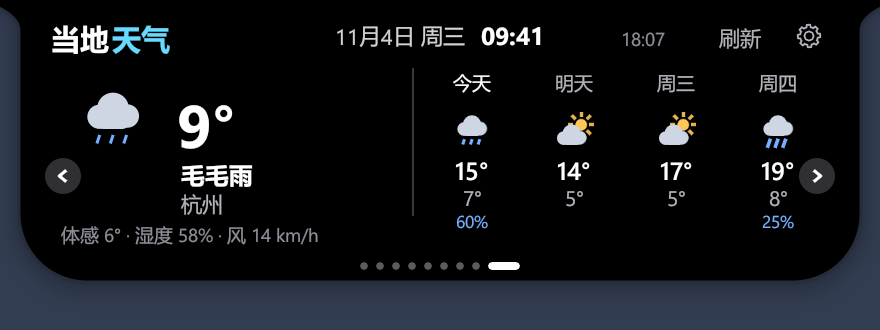
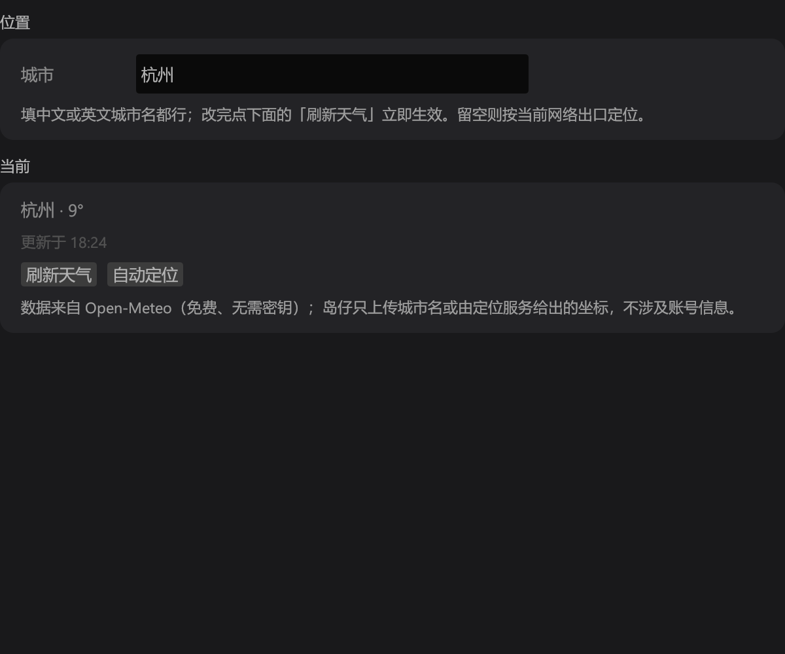

# 【功能建議】新增「天氣」版塊：當地實況 + 四日預報

> 建議類型：功能新增（新增第 9 個頁面 + 設定項「天氣」）
> 狀態：已有一份在本機跑通的完整實現（`src/weather.rs` + `src/weather_ui.rs`），可直接整理成 PR

## 背景

鬼島現在管著消息、音樂、日程和 AI 額度，但這些訊息裡少了一件每天出門前都要確認的事——天氣。它常駐在螢幕最上層、一眼就能看到，天生適合放「現在幾度、要不要帶傘」這種一次只讀一眼的短訊息。

島上頂欄的日期與時鐘已經有了，溫度是順理成章的延伸：不用切窗口、不用掏手機，抬眼就能看到。

目前社區裡已有 `[功能]` 類建議若干（置頂、雲同步、週期提醒等），天氣尚未有人提過，檢索 `weather` / `天氣` 無重複 issue。

---

## 一、頁面設計

### 佈局

沿用現有頁面的卡片語言：左側「當下」，右側「往後四天」，中間一條豎分隔線。

```
┌──────────────────────────────────────────────────────────────┐
│  當地 天氣              11月4日 週三  09:41   18:07  刷新  ⚙  │
│                                                              │
│      ☁☂        9°   │   今天    明天    週三    週四          │
│                     │   ☁☂     ⛅      ⛅      ☁☂           │
│    毛毛雨            │   15°     14°     17°     19°          │
│    杭州              │    7°      5°      5°      8°          │
│                     │   60%                      25%          │
│  體感 6° · 溼度 58% · 風 14 km/h                              │
│                                                              │
│                      ● ● ● ● ● ● ● ● ●                       │
└──────────────────────────────────────────────────────────────┘
```

- **左區**：矢量天氣圖標（42px）+ 溫度（30pt，取整顯示，不帶小數）+ 天氣現象文案 + 城市名；底部一行 meta 只顯示服務端真給了值的字段（體感 / 溼度 / 風速），缺哪個就少顯示哪個，不留空佔位。
- **右區**：四列預報，標籤為「今天 / 明天 / 週三 / 週四」，每列從上到下是圖標、最高溫（粗）、最低溫（弱）、降水概率（**≥20% 才顯示**，避免乾燥天滿屏 0%）。
- **頂欄右側**：「刷新」熱區位於返回音樂與設定按鈕左側；載入中時文案變「更新中」並置灰。更新時間位於右下方來源連結旁。
- **左右翻頁箭頭**：天氣頁內容比其它頁高，箭頭縱向位置單獨調整為 `arrow_y = 88`，避免壓住 meta 行。

### 截圖

| 天氣頁 | 設定 → 天氣 |
| --- | --- |
|  |  |

> 兩張圖均為無窗口測試宿主導出的真實渲染結果（非手繪稿）。提交 issue 時需要把 `docs/issue-assets/` 下兩張圖拖進編輯框。

### 空狀態 / 異常態

不聯網或不給定位權限是常態，所以三種狀態都有明確文案，不做空白頁：

| 狀態 | 左側主文案 | 副文案 |
| --- | --- | --- |
| 首次載入 | 正在獲取當地天氣… | — |
| 拿不到數據 | 天氣暫時取不到 | 點右上「刷新」重試 / 在設定裡填寫城市 |
| 有緩存但已過期 | 正常顯示舊數據 | 頂部時間戳 + 「上次更新 18:07」提示 |

---

## 二、數據源選型

| 方案 | 密鑰 | 中國大陸直連 | 數據質量 | 結論 |
| --- | --- | --- | --- | --- |
| **Open-Meteo** | 不需要 | ✅ 實測可直連 | WMO code + 逐時/逐日，多模式融合 | **採用** |
| wttr.in | 不需要 | ⚠️ 時快時慢 | 聚合第三方，字段粗糙 | 備選 |
| 和風天氣 QWeather | 需註冊 key | ✅ | 國內最準 | 需使用者填 key，與「開箱即用」衝突 |
| 彩雲天氣 | 需申請 key 與商業授權 | ✅ | 分鐘級降水強 | 同上，且授權流程更重 |
| 中國天氣網 | 無公開 API | — | — | 不可行 |

選 Open-Meteo 的決定性原因是**零配置**：鬼島的既有設計是「裝好就能用」，讓使用者為了看個天氣去註冊開發者帳號拿 key 會直接把功能門檻抬到沒人用。

許可方面需要注意：Open-Meteo 的數據為 CC BY 4.0，免費額度面向非商業用途（具體條款以官網為準）。鬼島是開源免費軟體，屬非商業用途，但**必須署名**——天氣頁和設定頁提供 Open-Meteo 來源連結，設定頁同時提供 CC BY 4.0 許可連結；數據處理方式與許可連結記錄在 `THIRD_PARTY_NOTICES.txt`。

---

## 三、定位策略（這裡有個刻意設計）

天氣接口要的是經緯度，但「我在哪」這件事有兩種拿法，取捨不同：

- **直接信 IP 庫給的經緯度**：省一次請求，但 IP 定位的座標誤差經常是幾十公里甚至跨市（尤其移動網路、企業出口），落到隔壁城市的格點上就會明顯不準。
- **只用 IP 庫給的城市名，再拿城市名去查天氣**：多一次 geocoding 請求（幾十毫秒、同一個域名體系），但結果和使用者心裡「我在杭州」一致得多。

**當前實現採用前者**：自動定位使用 `ipwho.is` 返回的座標查詢天氣，城市名用作顯示標籤。使用者手動確認城市後，才使用 Open-Meteo geocoding 解析座標；網路出口位置不準確時可以手動指定城市。

定位服務的實測淘汰過程（都可以少踩一遍）：

| 服務 | 問題 |
| --- | --- |
| `ipapi.co` | 國內訪問被 Cloudflare 攔（403 / challenge） |
| `ip-api.com` | 免費版只給 HTTP，沒 HTTPS，桌面端不該為這個降級 |
| **`ipwho.is`** | ✅ HTTPS + `?lang=zh-CN` 直接返回中文城市名 |

本機實測（出口 IP 在湖北）定位結果為「武漢」，與運營商出口歸屬一致。

使用者手動填城市時走 geocoding 的 `name` 查詢，中英文都支援（`language=zh` 讓返回名是中文），填「杭州」「Hangzhou」都能命中；查不到時提示「沒找到「XX」這個城市」，不靜默失敗。

---

## 四、接口細節

### 1. 實況 + 預報

```
GET https://api.open-meteo.com/v1/forecast
```

| 參數 | 值 |
| --- | --- |
| `latitude` / `longitude` | 保留 4 位小數 |
| `current` | `temperature_2m,relative_humidity_2m,apparent_temperature,is_day,weather_code,wind_speed_10m` |
| `daily` | `weather_code,temperature_2m_max,temperature_2m_min,precipitation_probability_max` |
| `timezone` | `auto`（關鍵：否則返回 UTC，日期會錯一天） |
| `forecast_days` | `4` |

`is_day` 必須取——同一個 `weather_code = 0`，白天要畫太陽、夜裡要畫月亮。

### 2. 城市名 → 座標

```
GET https://geocoding-api.open-meteo.com/v1/search?name=杭州&count=1&language=zh&format=json
```

取 `results[0]` 的 `latitude` / `longitude` / `name`。

### 3. IP 定位

```
GET https://ipwho.is/?lang=zh-CN
```

取 `latitude` / `longitude` 作為自動查詢座標；顯示名稱取 `city` → 回退 `region` → 回退 `country`。`success == false` 時提示使用者手填城市。

### 4. WMO 天氣代碼 → 圖標 / 文案

接口返回的是 WMO 4677 數字碼，需要映射成 10 種圖標和中文描述：

| code | 圖標 | 文案 |
| --- | --- | --- |
| 0 | 太陽 / 月亮（按 `is_day`） | 晴 |
| 1 / 2 | 太陽+雲 | 晴間多雲 / 多雲 |
| 3 | 雲 | 陰 |
| 45 / 48 | 霧 | 霧 |
| 51 / 53 / 55 / 56 / 57 | 細雨 | 毛毛雨 / 小雨 / 細雨 / 凍雨 |
| 61 / 63 / 65 / 66 / 67 | 雨 | 小雨 / 中雨 / 大雨 / 凍雨 |
| 71 / 73 / 75 / 77 / 85 / 86 | 雪 | 小雪 / 中雪 / 大雪 / 米雪 / 陣雪 / 強陣雪 |
| 80 / 81 / 82 | 陣雨 | 陣雨 / 強陣雨 / 暴雨 |
| 95 / 96 / 99 | 閃電 | 雷陣雨 / 雷暴伴冰雹 |

圖標全部用 `Card` 矢量繪製（圓 + 多邊形 + 線段拼），**不引入任何 PNG / 字體圖標**，這樣在 125% / 150% 縮放下不會模糊，也不會把 exe 撐大。

---

## 五、刷新與降級

| 項 | 值 | 理由 |
| --- | --- | --- |
| 自動刷新間隔 | 900s（15 分鐘） | Open-Meteo 的實況本身就 15 分鐘一檔，刷更勤沒有新數據 |
| 成功後冷卻 | 30s | 防手抖連點「刷新」把免費額度打爆 |
| 失敗後冷卻 | 120s | 斷網時不至於每次 tick 都發請求卡住 |
| 請求超時 | 12s | 與項目內其它網路請求一致 |
| 緩存 | `%APPDATA%\kuidao\weather.json` | 只存最近一次快照，冷啟動先顯示舊數據再後台更新 |

取數走後台線程 + `mpsc` 輪詢（與 `quota` 模塊同構），**絕不在渲染線程裡髮網路請求**，避免斷網時界面卡死。

城市輸入保留為草稿，按回車或點「刷新天氣」才應用。確認其他城市後可以立即查詢；同一城市的手動與自動刷新共用請求間隔限制。關閉天氣模塊後不再啟動新查詢，已關閉模塊或城市已變更的在途結果不更新界面與緩存。

---

## 六、接入現有架構的改動面

鬼島的頁面是固定長度數組，加一頁要動的地方比較分散，列出來方便評估：

| 位置 | 改動 |
| --- | --- |
| `PAGE_NAMES` | `[&str; 8]` → `[&str; 9]`，末尾加 `"天氣"` |
| `Settings::visible_pages` / `page_order` | `[bool; 8]` → `[bool; 9]`、`[usize; 8]` → `[usize; 9]` |
| `App::dots` | `[Spring; 8]` → `[Spring; 9]` |
| 頁面分發 | `8 => self.page_weather(...)` |
| 標題 | `8 => ("當地", "天氣", theme::CYAN)` |
| 設定跳轉表 | `[1,2,3,5,4,7,11,8,12]`（新增 `12` 指向天氣設定） |
| `SETTINGS_GROUPS` | 加 `("天氣", 12, 12)`，側欄第 13 項 |
| `Settings::weather_city` | 新字段，預設空串（= 自動定位） |
| `bar_layout::WEATHER` | 常駐膠囊新增天氣槽（用原本空閒的槽位 5），緊貼時鐘右側，與時鐘成組、不參與排序 |
| `Layout::widen` | 抽出通用的槽位加寬方法，點數文字、時段時鐘、天氣溫度共用 |

### 向後兼容

老使用者的配置文件裡只有 8 頁的順序和可見性掩碼，升級後如果直接按 9 頁解析會整段失效。所以 `model::load` 裡做了遷移：

- `visible_pages`：接受 6~9 位，缺的位補 `true`（新頁面預設可見，符合預期）
- `page_order`：8 項且恰好是 0..8 的一個排列時，追加 `8` 到末尾
- 其餘字段解析邏輯不動，`weather_city` 缺失時用空串

已用 `v0649_settings_and_mail_accounts_survive_upgrade` 這類升級測試覆蓋：老配置讀入後原有設定全部保留、天氣頁按預設值出現。

---

## 七、隱私

- 只向 Open-Meteo 發經緯度（或使用者手填的城市名），自動定位時會查詢 `ipwho.is` 的網路出口位置，都是無帳號的公開接口。
- 不讀取任何登錄態、不上報設備標識；`weather.json` 只存本地用於離線展示。
- README 與 `docs/PRIVACY.md` 說明天氣接口、自動定位和本地緩存。

---

## 八、驗證情況

已在本機（Windows 11 + Rust stable-msvc）跑通：

- `cargo check --locked --all-targets` 通過，天氣模塊 **0 警告**
- 全量 `cargo test --locked --lib -- --test-threads=1`：**774 passed / 0 failed / 89 ignored**
  - 天氣相關共 10 個用例（8 通過 / 2 忽略）：數據層 6 個（實況+四日解析、缺溫度報錯、WMO 碼映射、15 分鐘過期判定、改城市觸發新請求、時間格式化）、頁面級 UI 迴歸 2 個（數據齊全時的排版 / 無數據時的空狀態文案）、手動預覽探針 2 個
  - 常駐徽標 2 個 UI 迴歸：溫度在時鐘右側且不重疊、點溫度進天氣頁；無數據 / 隱藏天氣頁不佔位
  - 佈局 3 個單測：天氣緊跟時鐘、自定義排序下仍成組、加寬後不與其它組件重疊（含全組合遍歷，`weather` 開關一起納入）
- `cargo build --locked --bin kuidao` 成功
- 真實聯網探針（`#[ignore]` 手動跑）：
  - 自動定位 → 武漢，10.1°，`code=3`（陰），四日 `12.2/7.2`、`13.5/6.2`、`16.1/7.8`、`15.5/10.4`（末兩日 56% 降水）
  - 手填「杭州」→ 9.2°，與手機天氣應用一致

測試環境不聯網：`weather_tick()` 正常執行模塊開關、結果丟棄與刷新判定，僅在 `cfg!(test)` 下跳過實際網路請求；測試自行注入 `Snapshot`，所以 UI 測試結果穩定、不依賴外網。

---

## 九、實現清單

```
新增  src/weather.rs                          數據層：定位、geocoding、取數、解析、緩存、冷卻
新增  src/weather_ui.rs                       界面層：頁面渲染、矢量圖標、設定頁
新增  assets/settings-icons/system/weather.svg 設定側欄圖標（藍色漸變圓角底 + 白色太陽雲，與既有圖標同風格）
改動  src/app.rs                             頁面註冊、跳轉表、標題、tick 掛載、箭頭位置、常駐徽標佈局與繪製
改動  src/bar_layout.rs                      天氣槽位、通用加寬、時鐘成組排序、佈局測試
改動  src/resident_settings.rs               設定頁常駐排列預覽帶上天氣徽標
改動  src/model.rs                           weather_city 字段、數組擴到 9、舊配置遷移
改動  src/extras.rs                          設定分組、側欄圖標、頁面描述
改動  src/lib.rs                             模塊註冊
改動  src/ui_tests.rs                        9 頁斷言更新 + 新測試
改動  README.md / CHANGELOG.md               功能說明與隱私說明
```

---

## 十、常駐膠囊上的溫度

島上收起時，時間後面緊跟一枚天氣徽標：迷你矢量圖標 + 當前溫度（`⛅ 9°`），點一下直接打開天氣頁，懸浮顯示「城市 · 天氣現象 · 更新於 HH:MM」。

幾個實現上的取捨：

- **不佔使用者排序**：`resident_order` 只排電池 / 吉祥物 / 時鐘 / 額度 / 音樂 / 專注六項，天氣固定粘在時鐘右邊、跟著時鐘一起被拖動，所以沒給設定頁加新的拖拽項。
- **寬度自適應**：`-12°` 這類更長的溫度會把槽位撐寬，其餘組件對稱讓位，不會壓到旁邊的額度環。
- **不顯示的條件**：沒有數據、使用者隱藏了天氣頁、或進了極簡模式時不佔位（否則細條上會留一段空白）。
- **提示框不能用 `on_hover_text`**：常駐膠囊上的懸浮層會蓋住指針，把按下那一幀的命中搶走，導致點不動。項目裡已有的 `bar_tooltip` 就是為此寫的（延遲 0.5 秒、按下時不彈、`interactable(false)`），天氣徽標複用它。
- 數據超過半小時沒更新時溫度轉灰，和額度徽標的過期處理一致。

## 十一、可選擴展（本次未做）

1. **天氣頁內左滑切城市**：現在改城市要去設定裡填，常用兩三個城市的人會嫌麻煩。
2. **極端天氣提醒**：降水概率 / 大風超閾值時在島上閃一次提示。
3. **側邊停靠模式**：豎向停靠時的時間列暫未加天氣，只處理了頂部/底部停靠的橫向膠囊。

---

*如果你認可這個方向，我可以把上面這套實現整理成 PR（含單元測試與 UI 迴歸測試，已在本機全量跑通）。*